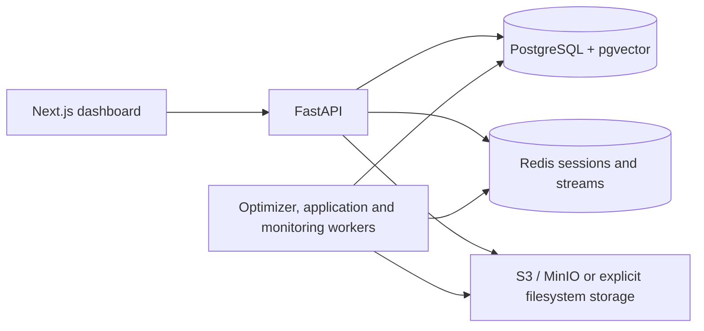

# JobForge

JobForge prepares job applications from a human-verified candidate profile:
job ingestion and fit evaluation, grounded resume and cover-letter drafts,
application answers, review, document rendering, permitted email submission,
and operational monitoring. The Next.js dashboard supports owner and reviewer
workflows, including profile/facts, approvals, agent activity and settings.

**Current baseline: M13 Phases 1–4, hardened by M14.** Exact implementation
history and verification results are in the
[milestone changelog](docs/MILESTONE_CHANGELOG.md). Architecture documents also
contain future design; they are not a claim that every planned feature exists.

Human approval remains mandatory. Defaults are `LLM_MODE=replay`,
`SUBMISSION_MODE=dry_run` and `EMAIL_TRANSPORT_MODE=fake`. A settings toggle
alone cannot send an application. Keep those values for development and tests.

## Architecture



PostgreSQL holds domain state, verified facts, citations, approval decisions,
events and audit records. Database constraints and separate service roles
reinforce application authorization. Redis stores revocable sessions and
supports event delivery. Rendering produces DOCX/PDF artifacts; the filesystem
backend is explicit, with no silent fallback from S3. Workers handle replayable
generation, application preparation, outbox delivery, retries and monitoring.
Only deliberate live configuration can enable external provider/SMTP traffic.

| Path | Responsibility |
|---|---|
| `apps/api/` | FastAPI routes, schemas, authentication and role dependencies |
| `apps/web/` | Next.js 15, React 19, TypeScript and Tailwind dashboard |
| `packages/shared/` | Configuration, IDs, clock, errors and logging |
| `packages/core/` | Models, grants-facing services, events and state machines |
| `packages/agents/` | Evaluation, drafting and verification orchestration |
| `packages/services/` | Ingestion, document rendering, storage and email transport |
| `workers/` | Process entrypoints and durable event consumers |
| `migrations/` | Ten Alembic revisions; head `0010_submission_retry_schedule` |
| `tests/` | Unit, integration, contract, offline evaluation and opt-in E2E |
| `infra/docker/` | Development and production Dockerfiles |
| `infra/terraform/` | Reserved directory; no deployed infrastructure supplied |

Dependencies flow from apps/agents/services toward core and shared code.
`make verify` checks the intended import direction; it currently reports 31
pre-existing upward imports (see the hygiene review). Workers are entrypoints,
not a library.
The schema check currently verifies 38 tables, 20 enums and ten revisions.

## Setup

Use a trusted local development machine with Docker Desktop/Compose and Make.
For host tools use Python 3.12 and Node 22. Development Compose publishes its
ports on the host interfaces; do not expose it as a public deployment. The
separate demo publishes only on loopback.

### Host tools

From the repository root:

```sh
python3.12 -m venv .venv
. .venv/bin/activate
python -m pip install -r requirements-dev.txt
(cd apps/web && npm ci)
pre-commit install
```

Commit both frontend manifests when changing dependencies. Do not replace
`npm ci` with an install fallback when a lockfile is invalid.

### Fictional demo for dashboard review

This creates its own generated, ignored `.env.demo`, database, credentials,
volumes and ports. Inspect existing services before starting another stack.

```sh
make demo-env
make demo-up
make demo-migrate
make demo-init
make demo-seed
```

Open [the demo](http://127.0.0.1:3100). Accounts are
`demo.candidate@example.com` (owner) and `demo.reviewer@example.com` (reviewer);
their generated passwords are in your local `.env.demo`. Do not share that
file. Optional `make demo-workers` starts only outbox, scheduler and monitor.
Full details: [demo environment](docs/DEMO_ENVIRONMENT.md).

### Development stack

```sh
test -f .env || cp .env.example .env
# Edit .env for this local stack before bootstrapping.
make bootstrap
make dev
make seed
```

Set local database/app-role passwords, a fresh `SESSION_SECRET`, and a fresh
`TOTP_ENCRYPTION_KEY`; leave provider keys empty and preserve the three safe
modes above. Generate a session secret with Python's `secrets.token_urlsafe(48)`
and a TOTP key with `make auth-key`; put values only in ignored local config.
`make bootstrap` applies migrations and configures app-role logins.
`make setup-auth` interactively sets the seeded owner's password and enrolls
TOTP. Its one-time provisioning URI is sensitive; keep it out of logs/screenshots.

| Service | Development | Isolated demo |
|---|---|---|
| Web | [localhost:3000](http://localhost:3000) | [127.0.0.1:3100](http://127.0.0.1:3100) |
| API docs | [localhost:8000/docs](http://localhost:8000/docs) | [127.0.0.1:8100/docs](http://127.0.0.1:8100/docs) |
| PostgreSQL | 5432 | 55433 |
| Redis | 6379 | 56380 |

Rendering/storage tests need MinIO (`make dev-full` also starts MailHog).
The default artifact backend is S3-compatible; configure its endpoint, bucket
and credentials. Host tools use `http://localhost:9000`; Compose overrides the
API endpoint to `http://minio:9000`. The demo explicitly uses filesystem storage.
Workers outside the demo require deliberate least-privileged DSNs; see
[worker runtime](docs/M4_RUNTIME.md). Do not use the schema owner's DSN as a
convenient worker fallback.

## Authentication, authorization and submission safety

The implemented login uses Argon2id passwords and encrypted TOTP secrets.
TOTP is optional only for `local`/`test`; a supplied code is still checked.
Other environments require TOTP. Sessions live in Redis, expire after 12 idle
hours or seven days absolute by default, and are revoked on logout. Session
cookies are HttpOnly and SameSite=Strict; Secure is enabled outside local/test.
The readable CSRF cookie must match `X-CSRF-Token` and the session-bound token
on mutations; login is the pre-session exception. Actor identity comes from
the session, never a caller-supplied ID.

This is a **shared candidate workspace**, not multi-tenant account isolation.
Owners and reviewers share review visibility; reviewers receive redacted
profile fields and cannot edit private profile/facts, import a master resume,
request first drafts, change submission settings or submit an application.
Review decisions remain human actions. Owner-only checks run on the server;
hiding a button is not authorization. See the
[approved boundary](docs/M7_AUTHORIZATION_BOUNDARY.md) and
[operations/security guide](docs/OPERATIONS.md).

Real email submission requires all of these: environment mode `enabled`, the
persisted owner-controlled switch, an explicit owner Submit action for that
application, complete current approvals/materials, a valid EMAIL site policy,
a grounded destination, and a not-yet-executed attempt. The destination comes
from persisted authoritative `mailto:` job data, not a submitted recipient field.
The SMTP transport is a separate choice and grants no authorization by itself.
Dry-run blocks real submission even if the persisted switch is on.

Verified facts and citation checks prevent fabricated claims; unresolved or
sensitive answers remain human-only. Unknown/unapproved site policies fail
closed. CAPTCHA-solving and stealth dependencies are prohibited. Tests use
replay/fake transports and never send real email or job applications.

## Testing and CI

Activate the virtualenv and configure a dedicated migrated test database,
Redis, MinIO and app-role passwords. Never run integration tests against a
production database. Preserve safe transport modes for the whole session:

```sh
export ENVIRONMENT=test LLM_MODE=replay SUBMISSION_MODE=dry_run
export EMAIL_TRANSPORT_MODE=fake REQUIRE_SECURITY_TESTS=1
ruff check .
ruff format --check .
mypy apps packages workers
pytest --cov --cov-report=term-missing --junitxml=test-results/backend.xml
python scripts/check_test_report.py test-results/backend.xml
pytest -m safety --junitxml=test-results/safety.xml
python scripts/check_test_report.py test-results/safety.xml
python scripts/run_offline_evals.py --report .eval-results/offline.json
pip-audit -r requirements-dev.txt
(cd apps/web && npm ci && npm audit && npm run lint && npm run typecheck && npm test && npm run build)
```

For service-free development, `pytest -m unit` runs the unit subset. Integration
fixtures can skip unavailable services unless required; a skipped test is not
verification. `REQUIRE_SECURITY_TESTS=1` and the report gate make required runs
fail closed. `make check` covers lint, types and unit tests; CI additionally
runs integration, security, production build and API E2E checks.

E2E remains opt-in and the two suites must use separate processes:

```sh
pytest -m e2e tests/e2e/test_m13_api_journeys.py
# Against the initialized fictional demo above:
playwright install chromium
pytest -m e2e tests/e2e/browser
```

The browser suite checks `.env.demo` identity and the running API's dry-run gate
before mutations. It creates uniquely named synthetic E2E rows. For Linux,
`playwright install --with-deps chromium` also installs browser system packages.
`--headed`, `--slowmo 250` and `-k review` are useful locally. Do not mix the
sync browser suite with async API journeys in one pytest session.

M14 verification: Phase 2 passed **3270 backend tests**, **1392 safety tests**,
**321 frontend tests**, **6 API journeys** and **17 browser journeys**. Phase 3
passed **1786 unit tests**, including four new hygiene checks. Python/npm audits
reported zero known vulnerabilities. These counts overlap and are a
point-in-time result, not totals to add. See the changelog for timings/limits.
[CI.md](docs/CI.md) describes every gate and the separate manual Playwright
workflow. Hosted Actions/image builds still require a hosted run; nothing in
M14 was pushed.

## Operations and troubleshooting

| Symptom | Check |
|---|---|
| Login succeeds but session disappears | Use one host spelling consistently; inspect Secure/environment flags and Redis. Local HTTP needs `ENVIRONMENT=local` or `test`. |
| 401, 403 or 429 | Check credentials/session, the server-side role policy, or the login rate limit. Do not bypass the limiter for repeated browser runs. |
| Security tests skip/fail | Confirm database/Redis reachability, `make migrate`, and `make db-roles` including app_audit. Use `make diagnose-roles`. |
| Rendering/MinIO tests fail | Start the intended MinIO and check endpoint/bucket/credentials. No automatic filesystem fallback exists. |
| Submission disabled with toggle on | The environment remains dry-run, or readiness/review/site-policy checks refuse dispatch. Keep dry-run during testing. |
| Demo page fails or port 3100 is occupied | Inspect the owning process. Avoid running two Next servers against the same `.next`; use a separate frontend directory/cache and `JOBFORGE_E2E_BASE_URL` for another port. |
| Docker `ENOMEM` or slow first compile | Check Docker Desktop resources. Stop unrelated workloads only with approval. `make demo-web-host` stops the demo web container before using the host; inspect first. |
| Profile edit returns 409 | Reload the latest profile/version, then reapply the intended edit. |
| Audit reports a new advisory | Review the affected path, select a compatible fix, regenerate the lockfile and repeat regression/audit checks; do not force major upgrades blindly. |

`GET /health` is dependency-free liveness. `GET /api/v1/health` checks PostgreSQL,
Redis and migration revision; Redis failure is degraded, database failure is
unavailable. The aliases are `/healthz` and `/readyz`. Use `make logs SVC=api`
and `make demo-logs SVC=api` for the corresponding stack.

`make down`/`make demo-down` retain volumes. `make clean`, `make db-reset` and
Compose `down -v` destroy data; inspect the target project and back up valued
data before any intentional reset. Avoid pasting logs containing PII or secrets.

## Limitations and repository hygiene

- `make verify` still fails its existing import-direction diagnostic (31 upward
  import occurrences). The secret-scan false positives from ignored tooling were
  repaired; the architecture rule remains unchanged. See the repository review.
- Collaborators share one workspace. Per-account tenant isolation, OIDC,
  WebAuthn/passkeys, personal access tokens and cloud deployment are not
  delivered features. Production authentication/infrastructure text in design
  documents describes planned work. `infra/terraform/` contains only a placeholder.
- Live execution supports the explicitly permitted email path; arbitrary ATS
  browser submission is not implemented. No CAPTCHA or anti-detection bypass.
- Replay generation needs matching cassettes; the fictional demo mainly exposes
  seeded review flows. No external model-quality claim follows from offline tests.
- The production web build does not use the development API rewrite. Configure
  its public API origin, cookie/CORS policy and deployment routing explicitly;
  this repository does not supply a production deployment recipe.
- Login limits use the socket peer, with no trusted-forwarded-header model.
  A reverse proxy can collapse clients into one rate-limit bucket.
- Browser runs leave synthetic E2E rows and can hit the deliberate login limit
  when repeated too quickly. Live-model evaluations remain opt-in/cost-bearing.
- Audits reflect the current advisory database. Scoped PostCSS/minimatch
  overrides need review on future dependency upgrades; ESLint 9 and `next lint`
  currently emit upstream deprecation/support notices while checks pass.

Never commit local env files, real profiles, generated application artifacts,
private keys, browser traces/HARs or stored authentication state. Ignore rules,
pre-commit and CI secret scanning provide checks, not permission to commit
sensitive data. Keep the reviewed baseline narrow. Generated browser reports
and auth-state directories are ignored. Public login artwork and synthetic
fixtures are intentional tracked assets. No repository license has been added.

Further references: [security design](docs/SECURITY.md),
[architecture](docs/ARCHITECTURE.md), [database design](docs/DATABASE_DESIGN.md),
[events](docs/EVENTS.md), [rendering](docs/M8_RENDERING.md),
[dependency review](docs/M14_SECURITY.md), [repository review](docs/REPOSITORY_HYGIENE.md).
