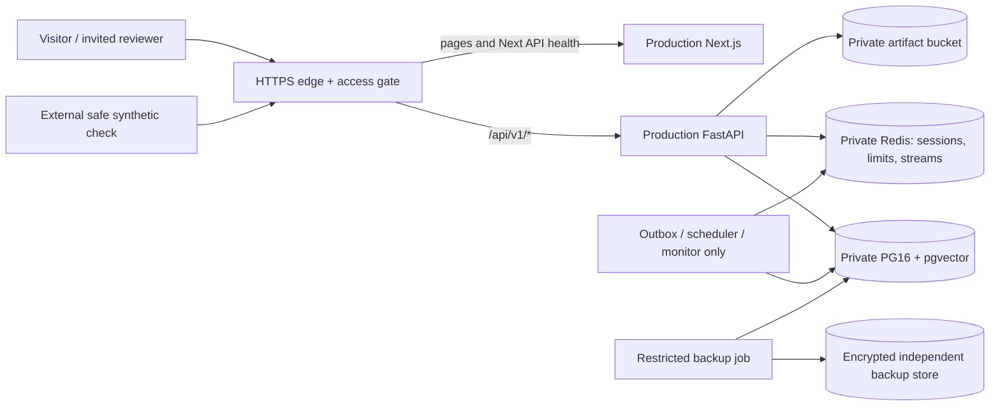

# JobForge M15 — deployment blueprint

**Status: future-use plan, not an executed deployment.** Assessed 2026-11-05 at
M14 baseline `d9bf368`. Current decision is **NO-GO**. All provisioning, DNS,
image publication, migration, backup and recovery commands in this document
are proposals requiring a separately authorized release. No credentials or real
secret values are included. Missing deployment/configuration artifacts are
requirements to implement and verify, not files claimed to exist.

Read the [readiness report](M15_READINESS_REPORT.md) for evidence, priority IDs,
current test results and limitations.

## 1. Recommended target and separation

Start with a **synthetic portfolio environment**, separate from any private
candidate workspace. Suggested first tier: one DigitalOcean Basic 8 GiB/4 vCPU
VM, private local PostgreSQL 16/pgvector and Redis, private Spaces object
storage, Caddy or a comparable TLS reverse proxy, encrypted off-host backups
and an external uptime/login-path check. Build images in CI, never on the live
VM. No MinIO or MailHog public console is needed; no local provider/model server.



Use one intended origin, for example `https://demo.example.invalid` (placeholder,
not a domain to provision). Route `/api/v1/*` to API:8000; pages/static assets
and `/api/health` to web:3000. Internal `/health` and detailed dependency readiness
are not unrestricted public diagnostics. Do not route every `/api/*` request
away from Next's health endpoint. Same-origin routing preserves host-only
session/CSRF cookies and avoids unnecessary CORS complications.

Only the edge publishes 80/443. Port 80 is solely ACME/HTTPS redirect if the
chosen challenge requires it. PostgreSQL 5432, Redis 6379, API 8000, web 3000,
metrics and backup endpoints are private/unpublished. Restrict management SSH
to an operator/VPN, use platform account MFA, and test IPv6 firewall rules too.
Use private Docker networks without application source bind mounts. Isolate
browser-facing web from DB secrets; only the API/workers can reach state stores.
Remote data-service connections need CA-validated TLS; same-host private bridge
traffic still needs an explicit threat-model decision, not an assertion of TLS.

TLS certificate issuance/renewal can be automated by a proxy such as
[Caddy](https://caddyserver.com/docs/automatic-https). Preserve certificate state,
monitor expiry, test renewal in staging, then enable HSTS after proving HTTPS
for the intended hostname. Do not casually preload HSTS. Add a tested CSP
(report-only during tuning, then enforcement), clickjacking/content-type/referrer
protections and a conservative body-size/connection/time budget. Next's inline
scripts need a compatible CSP/nonce/hash strategy; a guessed strict policy may
break the UI. Never cache authenticated responses/artifacts at a CDN.

A single VM is an accepted **demo failure domain**, not high availability.
For real candidate data, prefer private managed PG with PITR, private
Redis/Valkey, S3, and independently deployable API/web/workers. ECS/Fargate is a
viable later host after extension/grant/TLS validation and a funded operating
plan. No tenant isolation or anonymous-user product feature is added by this plan.

## 2. Cost and resource envelope

Prices checked 2026-11-05; USD, 730 hours, low-traffic US region, no free credits,
no live LLM or SMTP. Budget quantities and allowances are estimates, not quotes.

| Recommended demo line | Monthly budget | Assumption |
|---|---:|---|
| Basic VM, 8 GiB/4 shared vCPU | $48.00 | Production runtime only; builds elsewhere |
| Daily VM backup | $14.40 | Percentage model, 30% of VM; not a database restore guarantee |
| Private Spaces artifacts | $5.00 | Within 250 GiB storage / 1 TiB transfer allowance |
| Independent encrypted logical backup | $2–5 | Small database, separate failure/credential boundary; provider quote required |
| Logs, probes and alerts | $0–10 | Low volume; premium access-gate pricing could be additional |
| Domain amortization | $1–2 | Planning allowance only; no purchase made |
| **Total / initial budget alert** | **$70.40–84.40 / $90** | Excludes labor, taxes, overages and security incident costs |

Official inputs: [VM pricing](https://www.digitalocean.com/pricing/droplets),
[daily backup pricing](https://www.digitalocean.com/pricing/backups),
[Spaces](https://www.digitalocean.com/pricing/spaces-object-storage).
Storage/backup version growth must be monitored; set a spend alert, not an
assumption that billing stops at the alert amount.

Alternatives: Lightsail 8 GB IPv4 bundle $44 plus backups/storage/logs/domain
allowances gives roughly **$50–70/month**; its base has two vCPUs.
[Official bundle table](https://docs.aws.amazon.com/lightsail/latest/userguide/amazon-lightsail-bundles.html).
AWS managed single-AZ topology is approximately **$180–270/month** before
contingency; a more redundant two-AZ design roughly **$350–600+**. These are
planning estimates, not promised regional RDS/cache prices. The readiness report
shows task sizing, NAT/IPv4/ALB costs, assumptions and official pricing links.

Start with two API processes, one web, PG, Redis and only three monitoring/outbox
workers for the demo. Keep generation/render/submission workers off unless a
separate, controlled synthetic rehearsal requires one. Use per-container CPU,
memory, pids and file-descriptor limits; allow temporary writable mounts only
where rendering/Next caching requires them. Prefer read-only filesystems,
no-new-privileges and dropped capabilities after proving compatibility.

Example planning reservations: API 1 GiB, web 0.75 GiB, PG 1.5 GiB, Redis
0.5 GiB, workers 0.5 GiB total, proxy/OS/agents 1 GiB, remainder headroom.
These are **not measured limits**; verify under login/render/backup overlap.
Target a modest five-viewer synthetic test before launch, record p95 latency,
RSS/OOM, DB pool waits, disk/IO and stream lag, then set an actual capacity
limit. Keep peak memory below about 75% as an initial operational target.
Argon2 needs 64 MiB per concurrent hash; do not reduce hashing strength.

API DB connection ceiling is 28 at current two-process pool defaults, plus
workers (two domain connections each), inference audit pools and admin reserve.
Tune pools down before scaling tasks; do not exceed 70–80% of database capacity.
Verify shared storage, consumer-group claims, retry locks and scheduler behavior
before horizontally replicating workers. Choose one scheduler initially.

## 3. Environment variables and secrets

Read current definitions in `packages/shared/config.py`, not solely `.env.example`.
Use a service-by-service, validated config inventory. Settings do not implement a
general `*_FILE` convention: a proposed secret-file mechanism needs an entrypoint
or orchestrator injection into supported variable names. Do not assume a file
path is itself the value. Never put secrets in NEXT_PUBLIC variables, image
layers, Git, build arguments, CLI DSNs, screenshots or CI logs.

| Variables | Requirement / exposure |
|---|---|
| `ENVIRONMENT=production`, `DEBUG=false`, `LOG_FORMAT=json`, `LOG_LEVEL=INFO`, `APP_NAME`, `API_PREFIX=/api/v1` | Explicit non-local service configuration. Using local mode to get easier login is not acceptable on a public host. |
| `LLM_MODE=replay`, `SUBMISSION_MODE=dry_run`, `EMAIL_TRANSPORT_MODE=fake`, `RATE_LIMIT_ENABLED=true` | Mandatory demo safety preflight, checked again after boot and recovery. |
| `NEXT_PUBLIC_API_BASE_URL`, `NEXT_PUBLIC_API_PREFIX`, `NEXT_PUBLIC_APP_NAME` | Public values supplied **at web build time**. Recommended origin is the same HTTPS hostname as the UI. Add supported build inputs and fail on missing/malformed production origin; do not rely on runtime env replacing compiled code. |
| `CORS_ORIGINS` | Exact HTTPS origin list; no wildcard. This is an additional control, not authentication. |
| `DATABASE_URL` | Secret, explicitly URL-encoded async PostgreSQL DSN for app_api, with tested TLS options for the target. Avoid ambiguous password concatenation in parts-based defaults. |
| `POSTGRES_HOST/PORT/DB/USER/PASSWORD` | Alternative assembly inputs; `POSTGRES_PASSWORD` is also currently checked independently by production validation. Separate PostgreSQL administrator/bootstrap password belongs only to the data/admin job. Never run API as the schema owner. |
| `AUDIT_DATABASE_URL` | Secret app_audit DSN; configure explicitly to avoid privileged fallback. Test actual grants and durability under failure. |
| `WORKER_DATABASE_URL` | Per-worker secret, app_agent or app_monitor as checked by runtime. `WORKER_AGENT_DATABASE_URL` / `WORKER_MONITOR_DATABASE_URL` are Compose wiring inputs, not a replacement for per-process DSNs. `WORKER_PROFILE_ID` optional only when optimizer deliberately enabled. |
| Migration/admin DSN | Dedicated protected job credential injected as `DATABASE_URL` into the migration process. There is no generic `MIGRATION_DATABASE_URL` setting in the app. Establish ownership/elevation rather than assuming app_migrate can alter bootstrap-owned objects. |
| `REDIS_URL` or `REDIS_HOST/PORT/DB/PASSWORD` | Secret where authenticated; use private authenticated Redis and rediss/TLS for remote service, verified with the current client. No public port. Preserve `noeviction` and size limits deliberately. |
| `SESSION_SECRET` | Cryptographically random independent secret; used for keyed identifiers. It is not the Redis session token and rotating it alone does not revoke sessions. |
| `TOTP_ENCRYPTION_KEY` | Secret, base64 32 random bytes, independent of session secret. Store recoverably under separate key access controls; no live public shared TOTP enrollment. |
| `SESSION_IDLE_TIMEOUT_MINUTES`, `SESSION_ABSOLUTE_TIMEOUT_HOURS`, `SESSION_COOKIE_NAME`, `CSRF_COOKIE_NAME` | Review defaults (720 minutes, 168 hours); consider shorter demo sessions. Verify HttpOnly/Secure/SameSite and CSRF after TLS routing. |
| `ARTIFACT_STORAGE_BACKEND=s3`, `S3_ENDPOINT_URL`, `S3_BUCKET`, `S3_REGION` | Private managed bucket; HTTPS regional endpoint. For AWS default endpoint explicitly clear the localhost default rather than assuming AWS discovery overrides it. |
| `S3_ACCESS_KEY_ID`, `S3_SECRET_ACCESS_KEY` | Scoped Spaces credentials when used. On AWS, absent explicit keys allow boto3's normal credential chain; validate a least-privileged task role instead of assuming an IAM integration was tested. |
| `ARTIFACT_STORAGE_ROOT` | Only if explicitly selecting filesystem; dedicated persistent, protected and backed-up mount required. No ephemeral container-root artifact storage. |
| `ANTHROPIC_API_KEY` | **Absent in demo. Current validator rejects this in production even in replay: B02 must be fixed/tested first. Do not fill with a dummy or real key as a workaround.** |
| `SMTP_HOST/PORT/USERNAME/PASSWORD` | Absent/unusable in demo. A future live relay requires explicit TLS policy, failure/timeout testing, destination controls and separate authorization. |
| `LLM_MODEL_*`, `LLM_TAILORING_*_PRICE_PER_MILLION`, cost/application quotas and retry knobs | No live inference in demo. Review actual model support, pricing, quota and uncertain-outcome handling in a separately authorized live-readiness review. |
| `DB_POOL_*`, `AUDIT_DB_*`, `REDIS_MAX_CONNECTIONS`, `REDIS_SOCKET_TIMEOUT_SECONDS`, heartbeat/monitor thresholds and rate budgets | Set to measured limits and alert policy; no secrets. Do not disable checks to make a load test pass. |

Inject runtime secrets from an approved secret store or tightly permissioned
host files into only the relevant service. On a VPS, root/operator access to
Docker is privileged access to these secrets; restrict it. Encrypt backups and
escrow encryption keys separately. Rotate DB/object/provider credentials with
an explicit cutover and test plan. Rotating TOTP keys requires re-enrollment or
a reviewed decrypt/re-encrypt migration; a blind replacement locks users out.

## 4. Migration and rollback policy

Choose a target PG16 service that supports **pgcrypto, pg_trgm, btree_gin and
vector** and the required triggers/enums/grants. On managed PG, prove elevated
bootstrap operations and ownership limitations in a throwaway **new** staging
database. Provider support for pgvector is not proof that every role/grant SQL
statement is allowed. [RDS extensions](https://docs.aws.amazon.com/AmazonRDS/latest/UserGuide/Appendix.PostgreSQL.CommonDBATasks.Extensions.html).

Use one release migration job, never each API replica's startup. Split initial
extension/role bootstrap from least-privileged runtime. 0003 and 0005 honor
`JOBFORGE_SKIP_ROLE_GRANTS`; leave unset unless a reviewed, equivalent out-of-band
grant procedure has already succeeded and negative privilege tests prove it.
Do not disable security tests or grant broad privileges to get a green migration.

Future sequence, **not executed in M15**:

1. Take a verified encrypted backup and record image/source digests, current
   Alembic revision, configuration/key versions, PG/extensions and artifact
   version/checksum manifest. Freeze new writes and drain affected workers for
   incompatible changes. Maintenance windows are acceptable for the demo.
2. Set bounded DDL lock/statement timeouts in the reviewed migration connection;
   inspect the exact SQL, especially destructive DOWN scripts and long locks.
3. In the isolated rehearsal first, then the authorized release job, run
   `alembic current`, `alembic heads`, `alembic upgrade head` and `alembic current`.
   They use the job's injected `DATABASE_URL`, not a shell-pasted secret. Prove
   schema head equals the release expectation.
4. Verify ownership and app_api/app_agent/app_monitor/app_audit privileges using
   both positive and negative tests; login, CSRF, reads, artifact checksum and
   dry-run gate through the edge. Capture logs with no secret values.
5. Promote app images only when the schema is compatible. Keep the old digest
   available. Prefer expand/contract changes so an application rollback does
   not require a database rollback.

`gen_down_migration.py --check` only confirms generated SQL consistency; it
proves neither data preservation nor recoverability. Do not automatically run
`alembic downgrade`, `make db-reset`, `make clean` or Compose `down -v` on a failed
release. If a schema rollback is unavoidable, test the exact revision against
a restored isolated copy and obtain a separate destructive-change approval.
For an irreversible change, restore into a **new** database, reconcile writes
and cut over after validation; retain the original for investigation.

## 5. Backup and disaster recovery

Proposed targets (not demonstrated service levels): synthetic demo **RPO 24 h /
RTO 4 h** or rebuild from vetted fictional fixtures; real-data service **RPO
15 min / RTO 2 h** only after WAL/PITR and a timed restore drill prove them.
Choose managed PG/PITR or a reviewed WAL backup tool if the latter is required;
nightly dumps cannot meet a 15-minute RPO.

- Database: encrypted daily logical custom-format dump, seven daily and four
  weekly restore points as an initial policy. Capture global role/ownership
  definitions separately and protect them as credentials if password hashes
  are present. Keep an independent off-host copy; alert on missing/failed jobs.
- Artifacts: private versioned bucket, encryption, independent backup/replication
  or recovery copy, appropriate lifecycle for old versions/orphans. Confirm
  selected provider's versioning/encryption controls instead of assuming all
  S3-compatible features are equivalent. Align DB backup and object manifest;
  a restored DB must never point to deleted or wrong-version resume bytes.
- Keys/config: protected recoverable copies of TOTP/object/backup encryption
  material, schema/grant definitions and release manifests. Restore data
  without decryptable keys is not recovery.
- Redis: AOF/persistence is not the source of domain truth. Rebuild a fresh
  private instance after recovery to invalidate sessions and avoid resurrecting
  revoked ones. `DeliveryRuntime.reconcile()` can requeue published/unprocessed
  events from PG; test consumer claims/backlog recovery and retained event
  windows. Never clear the PG processed-event ledger or replay submissions
  blindly. The database itself can contain the persisted dispatch switch: keep
  it false and network egress blocked before any recovered worker starts.

Illustrative future backup/inspection commands, **not run here**; libpq service
files provide credentials, not command-line URLs:

```sh
PGSERVICE=jobforge_backup pg_dump --format=custom --file=jobforge.dump
pg_restore --list jobforge.dump
# Following restore targets a newly created, empty, isolated drill database only:
PGSERVICE=jobforge_restore_drill pg_restore --exit-on-error --dbname=jobforge_restore_drill jobforge.dump
```

Encrypt before off-host transfer; do not retain plaintext dumps in repository
folders. An app `postgresql+asyncpg://` DSN is not a libpq/pg_dump DSN.
Restore ownership/roles deliberately using a reviewed administrator, not casual
`--no-owner`/`--no-acl` options that strip safety grants. Rehearse permission
errors and append-only triggers. PostgreSQL documents dump consistency and
privilege requirements in [SQL dump backup](https://www.postgresql.org/docs/16/backup-dump.html).

Monthly drill: restore to a new isolated database/bucket namespace, recover
keys, verify schema/grants/counts and representative artifact checksums, sign in
with a drill account, test CSRF and dry-run refusal, reconcile a synthetic event,
measure elapsed time, record achieved RPO/RTO. Keep SMTP/provider egress blocked.
Do not attach real-data backups to a public demo. A retention change or drill
cleanup must be separately approved before deleting valued data.

## 6. CI/CD and release workflow

Current `ci.yml` checks dev/main, unit/integration/safety/API E2E, frontend
lint/types/tests/build, dependency/secrets checks, workflow lint and image builds
with `push: false`. Separate Playwright is manual. **M15 did not execute hosted
CI or production image builds.** No deployment job, registry release process or
remote branch-protection configuration is verified.

Future release pipeline:

1. PR from dev, required checks and code review; record the exact approved SHA.
   Include full safety/integration tests against isolated PG/Redis/MinIO and
   both E2E processes; no skipped required tests. Resolve or explicitly track
   A01 rather than presenting the scaffold aggregate as passing.
2. Build API/web/worker production targets in a clean runner with intended
   build-time public origin, pinned base-image digests and a reproducible Python
   transitive lock. Produce SBOM and scan application + OS dependencies.
   Sign/provenance-attest images; review newly discovered vulnerabilities.
3. Only in a separately authorized future release, publish to a private registry
   using short-lived scoped CI identity. No long-lived cloud keys in GitHub env
   or images. Preserve digests and retain at least the last two known-good sets.
4. Boot those **same digests** in isolated staging, migrate/rehearse rollback,
   run HTTPS/MFA/CSRF/role/download/safety probes and an appropriate soak test.
   A dev-server Playwright pass does not verify production cookie/proxy behavior.
5. Require an operator approval/environment gate, capture a pre-change backup,
   migrate once, deploy via a narrow release identity, and smoke-test before
   opening traffic. Do not grant the application deploy/registry admin rights.
6. Observe for an agreed interval, compare latency/errors/backlog/memory, record
   release manifest and rollback decision. For the demo, a short maintenance
   window is simpler than pretending a single node is zero-downtime HA.

Supply chain hardening, infrastructure manifests and bootstrap procedures are
implementation recommendations, not new product features delivered by M15.

## 7. Monitoring, logging and security acceptance

| Signal | Initial recommendation / response |
|---|---|
| Edge HTTPS and certificate | External probe every minute; page after repeated failures; expiry warning 21/7 days, test renewal. |
| Functional readiness | PG **and Redis** must work; current Redis-degraded HTTP 200 is insufficient for traffic routing. Validate a protected login/session path; detailed readiness remains private. |
| API latency/errors | Establish staging baseline; investigate sustained 5xx >1% or p95 read latency >1 s over five minutes as initial tuning thresholds, not measured SLOs. |
| Workers/queues | Heartbeats (15 s default), missing after configured threshold, durable consumer lag, dead letters, retry age and generation pause. No automatic live submission on recovery. |
| PG/Redis/storage | Connections/pool waits, locks, disk >75/85%, memory pressure, Redis noeviction/OOM, cache/stream growth, artifact readback errors. |
| Backups/security/spend | Backup age/failure, restore-drill age, certificate and key rotation, repeated auth failures, unexpected egress, image advisories, monthly spend alerts. |

Use structured JSON logs to stdout with rotation/size limits; retain application
logs 7–14 days initially and security/access evidence 30 days under restricted
access, subject to an approved privacy policy. Redact query/body/header data,
free-text errors and downloaded document contents; test with synthetic PII
canaries. Preserve opaque request IDs but bound/replace untrusted identifiers
at the edge. Do not expose health error strings, stack traces, metrics, database
names or bucket keys to unauthenticated visitors.

The code has operational alert records and monitoring snapshots; it does not
supply a Prometheus HTTP endpoint or an external paging configuration. Select
an external collector/probe, a verified destination and an incident owner.
Sending a test notification in a future drill requires authorization; none was
sent in M15. Kubernetes alone would not create these controls.

Before launch, verify all of the following and save evidence:

- [ ] B01–B05/B07 and launch-relevant B06/B08–B10 closed; exact release digests recorded.
- [ ] HTTPS/certificate renewal, no stateful public ports, restricted SSH/IPv6/egress; current headers and enforced CSP tested with UI.
- [ ] Non-local MFA, strong independent secrets, exact CORS, host-only Secure/HttpOnly/SameSite cookies, CSRF and logout/revocation tests through the proxy.
- [ ] Trusted peer chain: proxy strips attacker-supplied forwarding headers; Uvicorn trusts only the actual edge hop. Direct API access blocked. Do not use trust-all forwarding as a shortcut.
- [ ] Runtime app_api/app_audit and per-worker roles proven; no schema-owner app connection; DB/cache TLS/auth and storage privacy/encryption tested.
- [ ] Independent backup and timed restore/rebuild drill; keys recoverable; database/object consistency and session invalidation verified.
- [ ] Logging/privacy/retention policy approved; no real PII/cookies/provider/SMTP secrets in demo, browser traces, URLs or logs.
- [ ] Dependency and OS-image scans, hosted CI, no skipped gates, production smoke/soak and rollback evidence retained.
- [ ] Separate live-data/live-outbound review if ever requested; no tenant-isolation or compliance certification inferred.

## 8. Public portfolio controls

Use only fictional profiles, jobs, facts and generated documents, reserved
`.example`/`.invalid` destinations and separate database/bucket/key namespaces.
Never publish a clone of the private workspace. The current `.env.demo` helper
requires local mode; **do not bypass its identity guards** to seed a production
host. Create/review a dedicated non-local synthetic bootstrap job and enroll
TOTP for invited accounts before opening access (B03).

Publish a static project explanation/walkthrough if general audiences need
frictionless access; keep the interactive application behind an approved access
gate and invited reviewer accounts. Do not publish shared owner credentials or
weaken MFA to make the demo public. Application reviewers can mutate approvals,
so a read-oriented demo needs edge enforcement: allow GET/HEAD and required
OPTIONS, and only POST `/api/v1/auth/login` and `/api/v1/auth/logout` among unsafe
methods; deny other POST/PUT/PATCH/DELETE paths. Validate normalized paths and
method overrides against bypasses. Explain that write workflows are disabled
in this demonstration. An optional controlled owner walkthrough stays private.

Every boot and recovery must establish: replay/dry_run/fake; persisted
`submission_enabled=false`; no provider/SMTP credentials; no submission,
optimizer, first-draft, application, cover-letter or render workers; employer
and provider egress blocked. Assert the API submission gate reports `live=false`
through the deployed route. Test negative requests against every protected path,
not just hidden buttons. Capture no reusable storage-state files in public CI
artifacts. Rebuild/reset synthetic demo data only under an explicitly approved
procedure, never a scheduled destructive command against an ambiguous target.

## 9. Future deployment sequence and recovery

These steps are **not executable authorization** and were not performed here.
Stop at any failed check; do not substitute production credentials into ad-hoc
commands or relax checks to progress.

1. Approve launch scope (synthetic gated demo versus private real-data system),
   budget, recovery targets, hosting region and named operator. Re-price options.
2. Implement and test B01–B05/B07 changes on dev, plus the relevant operational
   blockers. Review first-account/MFA bootstrap, deployment manifests and secrets
   inventory. No product-feature expansion is required for a gated demo.
3. Obtain separate authorization for hosting/domain/registry resources; only
   then provision a dedicated target, firewall/private networks, encrypted
   volumes/private buckets, backup destination and TLS/DNS. Do not use the
   existing development Docker host as the public server.
4. Build/scan immutable production images with the approved public origin.
   Verify target architecture compatibility (x86/ARM) and native dependencies.
   Do not infer this from local Python tests or development container health.
5. Rehearse fresh PG/extensions/roles/migrations on staging, then account/MFA
   bootstrap and artifact storage with synthetic fixtures only. Test backup
   and rollback before touching any valued data.
6. Configure secrets outside source/images, deploy one-off migration/bootstrap
   jobs under restricted identities, then API/web and selected workers. Keep
   network access private while verifying readiness and version/digest markers.
7. Test the actual HTTPS path: login, Secure cookies, CSRF, forbidden reviewer
   operations, expired sessions, artifact checksum, safety gate and failure
   handling when Redis/storage are unavailable. Avoid deliberate disruption
   to existing shared containers; failure injection belongs to isolated staging.
8. Run production image browser/API smoke and a bounded synthetic load/soak.
   Verify alerts, backup freshness and external probe; record exact commands,
   counts and limitations as release evidence.
9. After operator approval, expose only the intended origin/access policy.
   Observe metrics and logs. If conditions regress, close ingress and roll back;
   do not enable external delivery as a troubleshooting shortcut.
10. Record the release and follow-up risks; real-data/live-send enablement is
    another approval requiring the full B06/B11/B12 gates, not the next default step.

Rollback triggers: failed auth/CSRF or role checks, any unexpected real outbound
capability, artifact integrity errors, sustained readiness/5xx problems, missing
backup or OOM pressure. First close demo ingress, keep dry-run/fake and egress
blocks enforced, stop only the affected release's consumers, and preserve evidence.
Redeploy the last compatible image digests/config versions. Never automatically
reverse schema changes or restore stale credentials. If data integrity is in
doubt, restore into a new isolated PG/bucket namespace, validate permissions,
keys, revisions and checksums, reconcile durable event/processed-event records,
invalidate sessions with a fresh Redis, then switch endpoints under approval.

For any future real SMTP operation, an accepted message with lost acknowledgment
is an uncertain external side effect: do not blindly retry after restore.
Reconcile message IDs/attempt evidence and require human resolution. Prove
required TLS/certificate validation and timeout/error behavior of the real relay
before enabling it; current transport code does not explicitly configure that
TLS policy. Network-disabled synthetic tests cannot prove real delivery safety.

The result of M15 is this plan and a **NO-GO** assessment, not a deployment-ready
claim. A later release can become CONDITIONAL GO only when its closure evidence,
remaining risk acceptance, backup/rollback proof and operating budget are reviewed.
